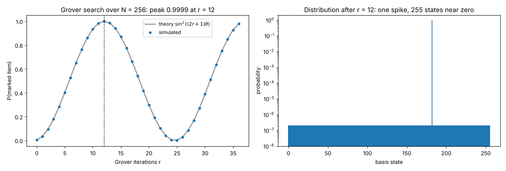
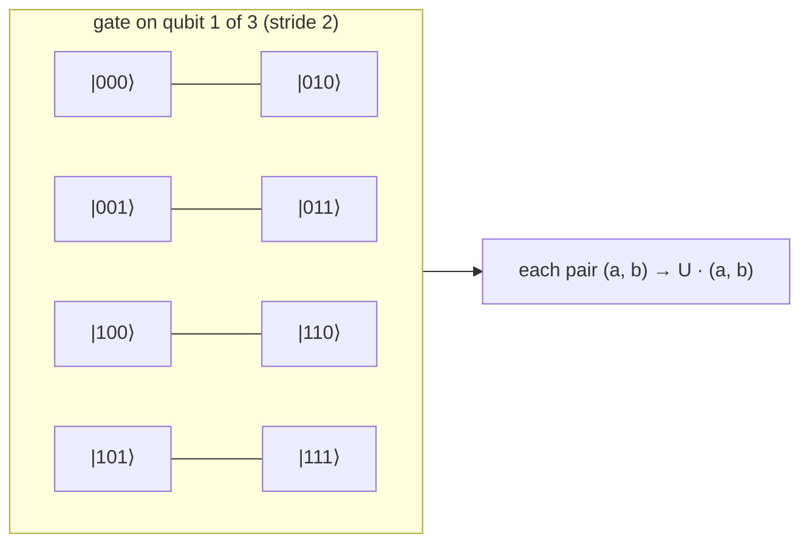

# qsim-rs

A state-vector quantum circuit simulator in Rust with no dependencies. It covers gates, controlled
gates, measurement, the quantum Fourier transform and Grover's search, all verified against
closed-form results.



Grover's search over 256 items finds the marked one with probability 0.9999 after
⌊π/4θ⌋ = 12 iterations. The simulation lands exactly on $\sin^2((2r+1)\theta)$ at every step, and
too many iterations rotate the state back past the answer.

## Usage

```rust
use qsim::{algorithms, StateVector};

let mut s = StateVector::new(3);
s.h(0).cnot(0, 1).cnot(1, 2);          // GHZ state (|000⟩ + |111⟩)/√2
let p = s.probabilities();

let mut f = StateVector::basis(4, 5);  // |0101⟩
algorithms::qft(&mut f);               // amplitudes e^{2πi·5y/16}/4
```

Available gates: `H X Y Z S T`, `phase(θ)`, `rx ry rz`, any 2×2 unitary, multi-controlled versions
of all of them, plus `cnot cz cphase toffoli swap`. Measurement is available both as sampling and
as collapse.

## How it works

The state of n qubits is 2ⁿ complex amplitudes, with qubit q as bit q of the index. A gate on
qubit q never needs a 2ⁿ × 2ⁿ matrix: it pairs every index whose bit q is 0 with its partner whose
bit q is 1, and multiplies each pair by the 2×2 matrix:



That makes each gate O(2ⁿ) time with no extra memory. Control qubits just skip the pairs where a
control bit is 0.

**QFT.** n Hadamards plus n(n−1)/2 controlled phases $R_k = \mathrm{diag}(1, e^{2\pi i/2^k})$, then
the qubits are reversed. That is O(n²) gates acting on N = 2ⁿ amplitudes, the exponential
compression that algorithms such as phase estimation and Shor's rely on.

**Grover.** Each iteration is a phase oracle followed by $H^{\otimes n}(2|0\rangle\langle 0| - I)H^{\otimes n}$,
a reflection about the uniform superposition. Together these rotate the state by 2θ towards the
marked item, with $\sin\theta = 1/\sqrt N$.

## Tests (all against exact results)

| test | what it checks |
|---|---|
| `qft_matches_the_discrete_fourier_transform` | every basis input of a 4-qubit QFT gives $e^{2\pi i xy/N}/\sqrt N$ to 1e-12 |
| `inverse_qft_undoes_qft` | QFT⁻¹·QFT = I on a random 7-qubit state |
| `grover_matches_the_analytic_success_probability` | $\sin^2((2r+1)\theta)$ for r = 0…11, to 1e-12 |
| `pauli_algebra_xyz_is_i_times_identity` | XYZ = iI |
| `toffoli_truth_table` | all 8 inputs |
| `bell_and_ghz_states_have_the_right_correlations` | only the all-0 and all-1 outcomes appear |
| `measuring_one_half_of_a_bell_pair_fixes_the_other` | collapse and renormalisation |
| `measurement_statistics_follow_the_born_rule` | 20,000 shots land within 4σ of 50/50 |
| `random_circuits_preserve_the_norm` | 500 random gates keep the norm at 1 to 1e-12 |

## Scaling

`cargo run --release --example bench`, single thread:

| qubits | amplitudes | memory | time per H gate |
|---:|---:|---:|---:|
| 16 | 65,536 | 1 MiB | 0.11 ms |
| 20 | 1,048,576 | 16 MiB | 1.6 ms |
| 24 | 16,777,216 | 256 MiB | 45 ms |

Each extra qubit doubles both the memory and the time. That is the exponential wall that makes
classical simulation of large quantum computers infeasible, at about 16 bytes × 2ⁿ: roughly 30 qubits
fit in 16 GiB.

## Run it

```bash
cargo test --release
cargo run --release --example grover_curve > docs/grover.csv && python scripts/plot_grover.py
cargo run --release --example bench
```

## Next steps

Parallelise the pair loop (the pairs are independent), add a noise model with density matrices or
quantum trajectories, and add phase estimation on top of the QFT.

## License

Copyright (c) 2026 Ankit Pawar. All Rights Reserved.

This repository is public so that the work can be read and evaluated, but it is not open source. Using, copying, modifying, redistributing or commercially exploiting any part of it requires prior written permission. This does not affect what applicable law allows without permission, or viewing and forking the repository on GitHub under GitHub's Terms of Service. The full terms are in [LICENSE](LICENSE).

Commits up to and including `62745ce` were released under the MIT License, and copies obtained under those terms keep them.

For licensing or collaboration, email ankitpawar0007x@gmail.com or visit [ankitinorbit.com](https://ankitinorbit.com).
